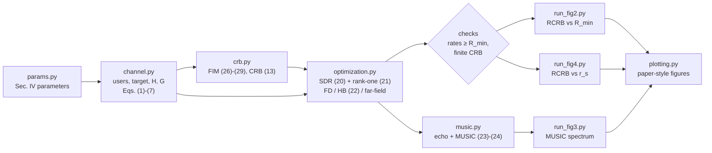
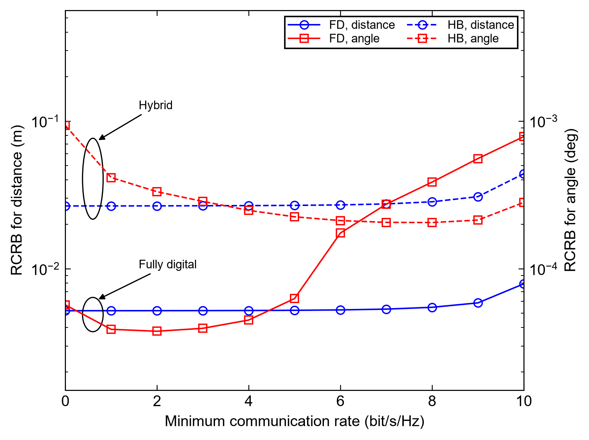
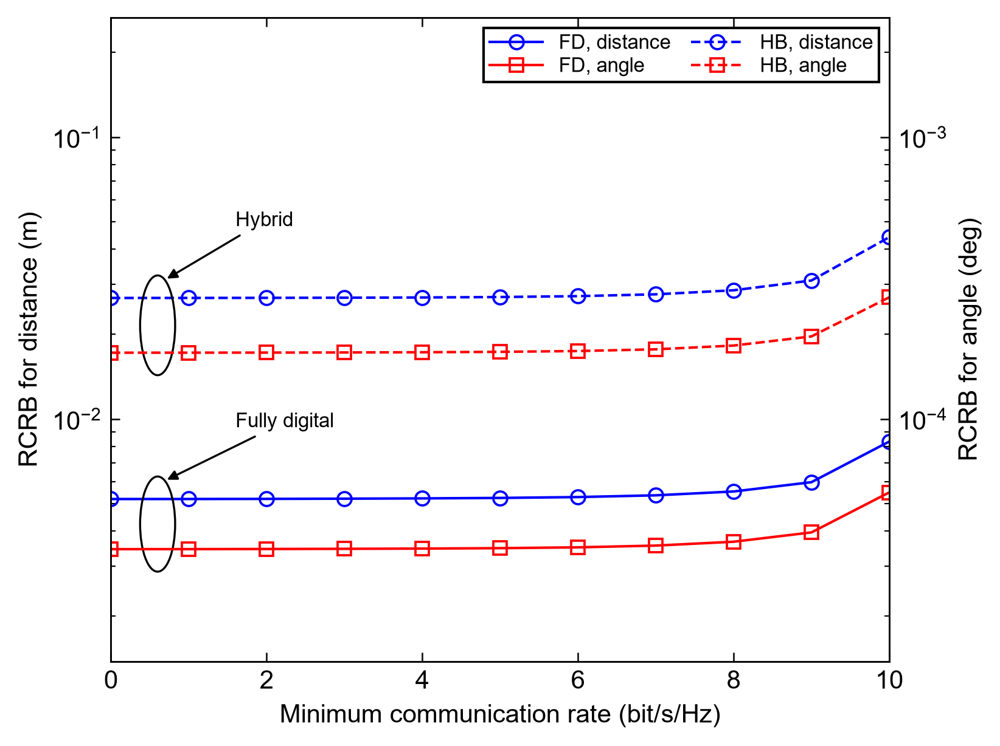
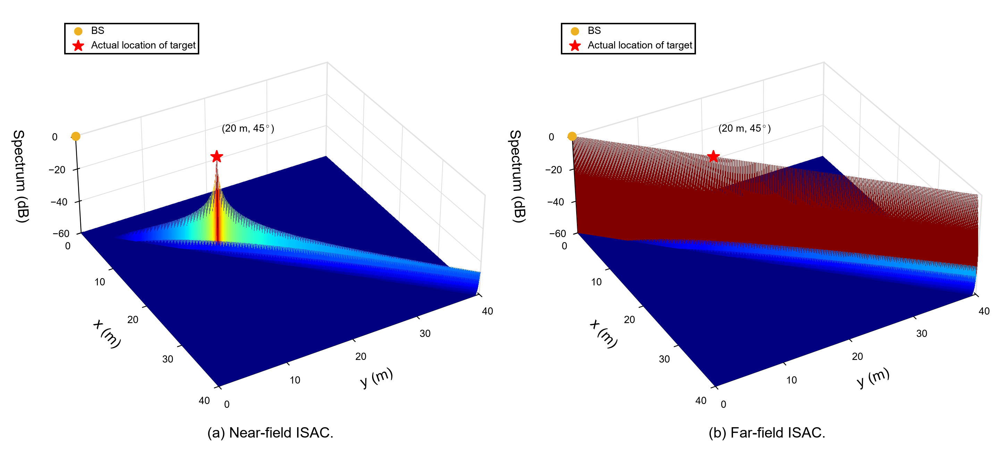
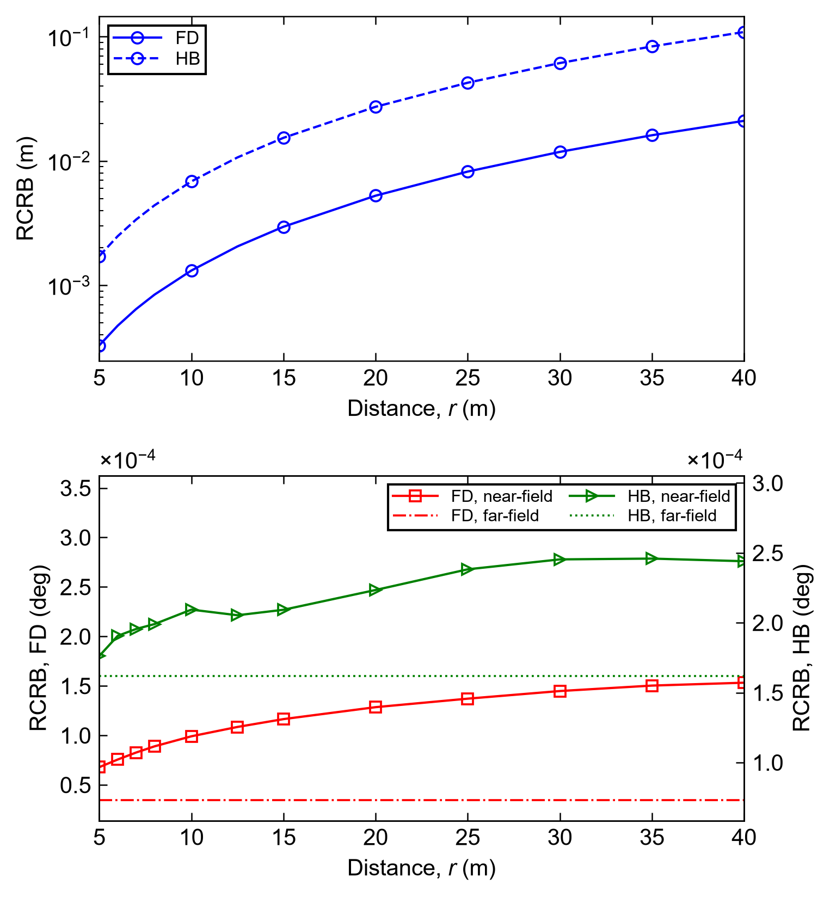
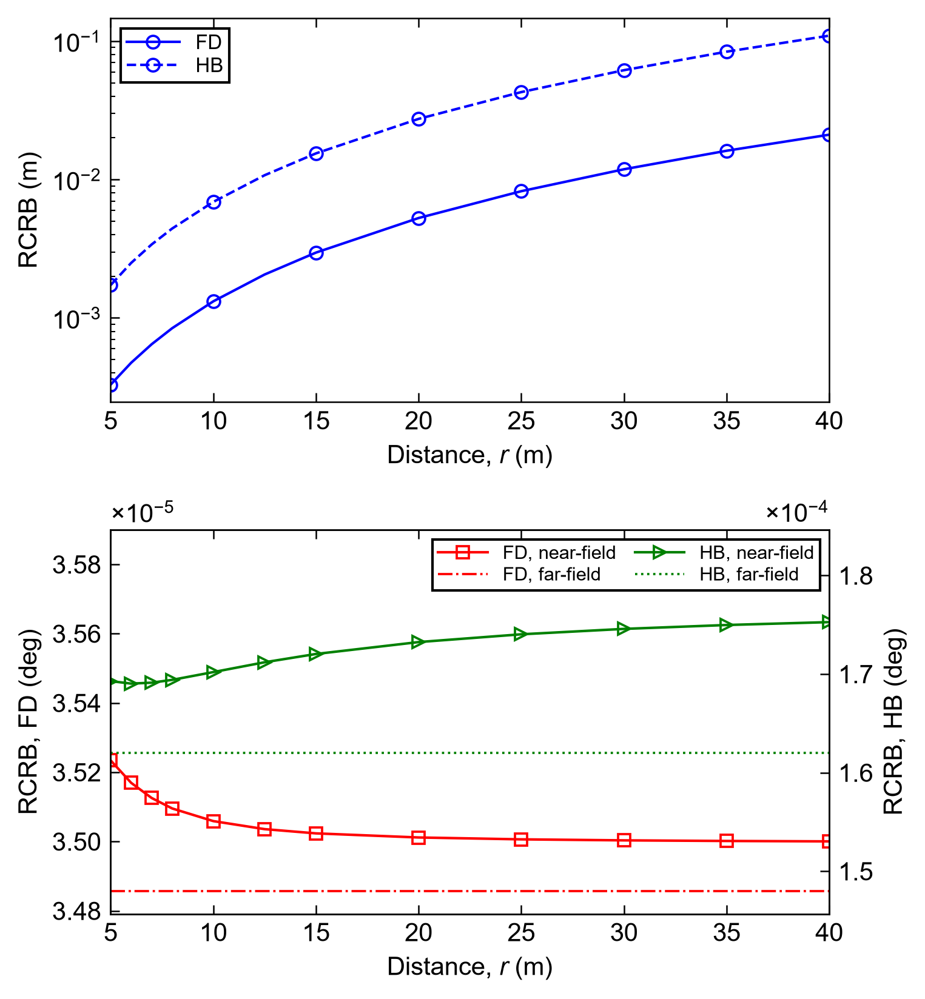
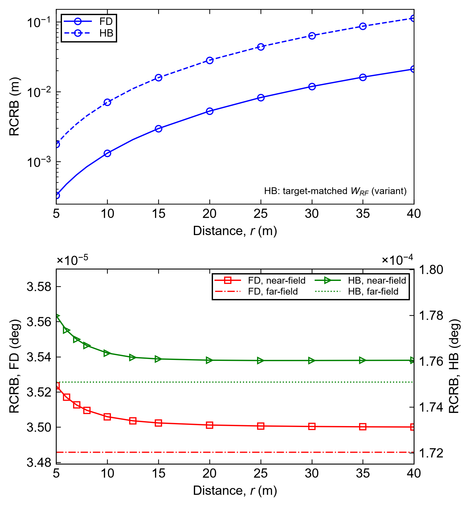
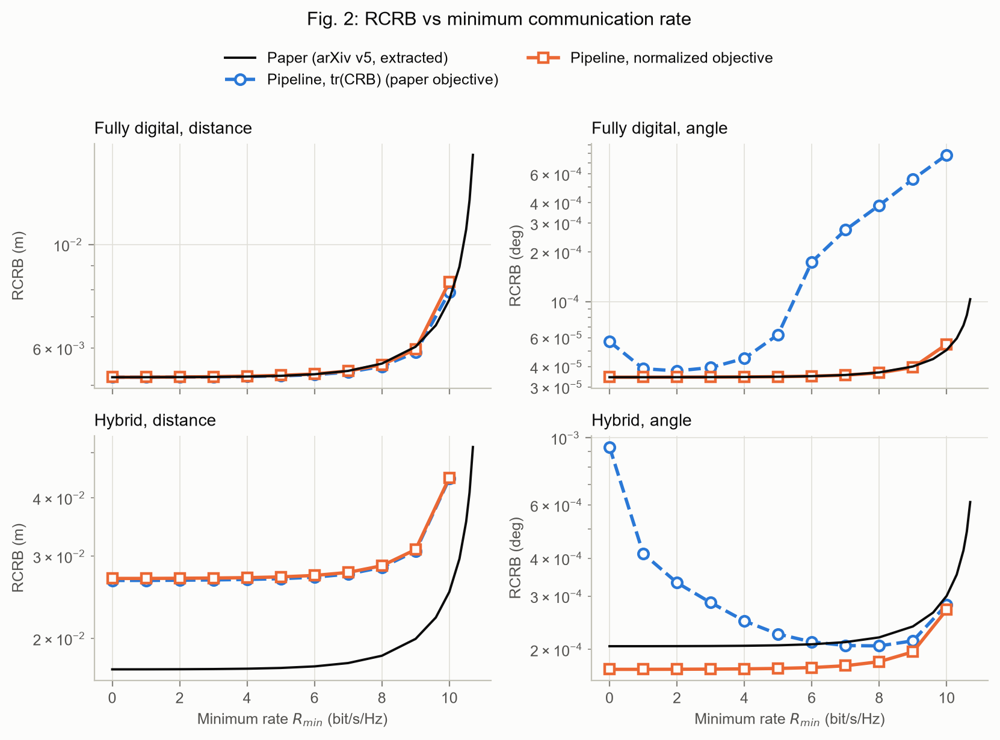
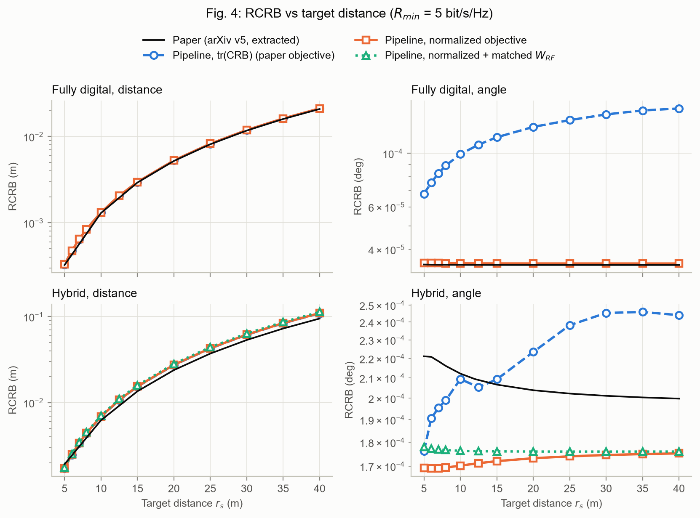

# Near-Field ISAC: reproduction of Wang, Mu & Liu (IEEE CL 2023)

A Python reproduction of the numerical results (Fig. 2, Fig. 3 and Fig. 4) of

> Z. Wang, X. Mu, and Y. Liu, "Near-Field Integrated Sensing and Communications,"
> *IEEE Communications Letters*, vol. 27, no. 8, pp. 2048–2052, Aug. 2023.
> doi: [10.1109/LCOMM.2023.3280132](https://doi.org/10.1109/LCOMM.2023.3280132) ·
> arXiv: [2302.01153](https://arxiv.org/abs/2302.01153)

The letter jointly designs the transmit waveform of a near-field base station so that it serves $K$
communication users with a minimum rate and also estimates the **distance and angle** of a target. The
estimation accuracy is measured by the Cramér–Rao bound (CRB). This repository implements the system model,
the CRB, the semidefinite-relaxation (SDR) designs for fully digital (FD) and hybrid (HB) arrays and the MUSIC
estimator. It cross-checks them against the authors' MATLAB code
([zhaolin820/near-field-integrated-sensing-and-communications](https://github.com/zhaolin820/near-field-integrated-sensing-and-communications)),
which covers the FD design and MUSIC but not the hybrid design or Fig. 2.

Beyond reproducing the figures, the repository documents two problems we found in the problem as stated:

1. **The paper's objective $\mathrm{tr}(\mathrm{CRB})$ is dominated by the distance term.** It adds m² to rad²,
   and at the paper's operating point the angle term is only $10^{-8}$–$10^{-7}$ of the objective. The angle accuracy
   is therefore not optimized at all, and the solver returns an arbitrary point for it.
2. **The hybrid receive combiner $\mathbf W_{RF}$ is random.** The shape of the hybrid angle curve then depends
   on the particular draw.

We propose a **normalized (unit-free) CRB objective** and a **target-matched analog combiner**. With them the
FD curves match the paper within about 1–2 %, and the hybrid curves have the paper's shape (see
[Discussion](#discussion-why-the-literal-problem-does-not-give-the-papers-curves)).

---

## Contents

- [Highlights](#highlights)
- [System model and problem](#system-model-and-problem)
- [Implementation](#implementation)
- [Repository layout](#repository-layout)
- [Installation](#installation)
- [Usage](#usage)
- [Results](#results)
- [Discussion: why the literal problem does not give the paper's curves](#discussion-why-the-literal-problem-does-not-give-the-papers-curves)
- [Comparison with the paper](#comparison-with-the-paper)
- [Differences from the paper and limitations](#differences-from-the-paper-and-limitations)
- [Tests](#tests)
- [References](#references)

---

## Highlights

- **Faithful model.** The channel model (Eqs. 1–7), echo model (12), FIM blocks (26)–(29), CRB (13), rate (11),
  SDR problem (20), rank-one reconstruction (21), the two-stage hybrid design (22) and MUSIC (23)–(24) follow
  the paper. The parameters come from Sec. IV and, where the paper is silent, from the authors' `para_init.m`.
- **Validated FIM.** The analytical FIM matches the Fisher information computed by numerical differentiation of
  the echo mean (`tests/test_model.py`).
- **Two solvers for problem (20).**
  - `--formulation paper` solves (20) exactly as written: full $N\times N$ variables and the authors' own
    scaling. The problem is passed to MOSEK Fusion directly, which takes 2–5 s per solve instead of more than
    15 min through CVXPY.
  - `--formulation fast` solves an *exactly equivalent* reformulation: a subspace reduction to $7\times7$
    variables and a whitened hybrid stage. It takes about 0.15 s per solve and reaches the same optimum (checked
    by the tests).
- **Proposed formulation** (optional flags): `--objective normalized` and `--wrf matched`.
- **Reproducible Monte Carlo.** Every realization has its own seeded random generator, so the results do not
  depend on the number of worker processes.

---

## System model and problem

**Geometry and channels** (Sec. II-A). The base station has a uniform linear array with $N = 2\tilde N+1$
antennas and aperture $D$ along the x-axis. A point at distance $r$ and angle $\theta$ is at distance
$r_n = \sqrt{r^2 + n^2d^2 - 2rnd\cos\theta}$ from element $n$. The near-field array response is
$[\mathbf a(r,\theta)]_n = e^{-j\frac{2\pi}{\lambda}(r_n - r)}$, and its far-field limit is
$[\mathbf a(\theta)]_n = e^{\,j\frac{2\pi}{\lambda} nd\cos\theta}$. User $k$ has channel
$\mathbf h_k = \beta_k\,\mathbf a(r_k,\theta_k)$. The target echo goes through
$\mathbf G = \beta_s\,\mathbf a(r_s,\theta_s)\,\mathbf a^T(r_s,\theta_s)$.

**Transmit signal and rate.** The transmitted signal is $\mathbf x[t] = \sum_k \mathbf p_k c_k[t] + \mathbf s[t]$,
with covariance $\mathbf R_x$. User $k$ achieves

$$R_k = \log_2\Big(1 + \frac{|\mathbf h_k^T\mathbf p_k|^2}{\mathbf h_k^T\mathbf R_x\mathbf h_k^* - |\mathbf h_k^T\mathbf p_k|^2 + \sigma_k^2}\Big).$$

**Sensing.** The unknowns are $\boldsymbol\xi = [r_s, \theta_s, \mathrm{Re}\,\beta_s, \mathrm{Im}\,\beta_s]$. The FIM
blocks (26)–(29) are affine in $\mathbf R_x$, and

$$\mathrm{CRB}(r_s,\theta_s) = \big(\mathbf J_{11} - \mathbf J_{12}\mathbf J_{22}^{-1}\mathbf J_{12}^T\big)^{-1}.$$

**Problem (16), with its SDR (20)** (Sec. III-B):

$$\begin{aligned}
\min_{\mathbf P_k\succeq 0,\ \mathbf R_x\succeq 0,\ \mathbf U\succeq 0}\quad & \mathrm{tr}(\mathbf U^{-1}) \\
\text{s.t.}\quad & \begin{bmatrix}\mathbf J_{11}-\mathbf U & \mathbf J_{12}\\ \mathbf J_{12}^T & \mathbf J_{22}\end{bmatrix}\succeq 0,
\qquad \gamma_k\,\mathbf h_k^T\mathbf P_k\mathbf h_k^* \ge \mathbf h_k^T\mathbf R_x\mathbf h_k^* + \sigma_k^2,\ \ \gamma_k = 1+\tfrac{1}{2^{R_{\min}}-1}, \\
& \mathrm{tr}(\mathbf R_x)\le P_{\max},\qquad \mathbf R_x - \textstyle\sum_k \mathbf P_k \succeq 0 .
\end{aligned}$$

The relaxation is tight: the rank-one beamformers $\mathbf p_k = (\mathbf h_k^T\mathbf P_k\mathbf h_k^*)^{-1/2}\mathbf P_k\mathbf h_k^*$
of Eq. (21) are globally optimal for (16).

**Hybrid array** (Sec. II-C, III-C). The array has $N_{RF}$ RF chains and analog transmit beams
$\mathbf P_{RF}$ given by Eq. (22): one beam per user and the remaining beams on the target. The receiver uses an
analog combiner $\mathbf W_{RF}$ with unit-modulus random entries (ref. [15] of the letter), so the effective
echo noise is $N\sigma_s^2$. The digital stage solves the same SDR in $\mathbf R_{BB}$, with
$\mathbf R_{HB} = \mathbf P_{RF}\mathbf R_{BB}\mathbf P_{RF}^H$ and $\mathrm{CRB}(\mathbf R_{HB}, \mathbf W_{RF}\mathbf G, N\sigma_s^2)$.

**Parameters** (Sec. IV): $N = 65$, $N_{RF} = 5$, $D = 0.5$ m, $f_c = 28$ GHz ($\lambda = 1.07$ cm, Rayleigh
distance 46.7 m), $K = 4$, target at $(20\text{ m}, 45^\circ)$, $P_{\max} = 20$ dBm, $\sigma^2 = -60$ dBm,
$T = 128$ snapshots, and $\rho_0 = \lambda/4\pi$ (both from `para_init.m`). Users are placed uniformly in the
near-field region, $r_k\sim\mathcal U[1.2D,\ 2D^2/\lambda]$ and $\theta_k\sim\mathcal U(0,\pi)$.

---

## Implementation

### Pipeline



For **each Monte Carlo realization** of Fig. 2 and Fig. 4:

1. Draw 4 user positions and one random $\mathbf W_{RF}$ with `default_rng([seed, idx])`.
2. For every $R_{\min}$ (Fig. 2) or every $r_s$ (Fig. 4), solve the FD problem and the HB problem (stage 1:
   Eq. (22); stage 2: the SDR in $\mathbf R_{BB}$), then reconstruct rank-one beamformers.
3. Check the solution again with Eqs. (11) and (13). A design is accepted only if every rate is at least
   $R_{\min} - 10^{-3}$ and the CRB is finite. A realization that fails at *any* point is discarded, so every
   point of a curve is averaged over the same users.
4. Average the CRB matrices over 100 feasible realizations, then take the square root:
   $\mathrm{RCRB} = \sqrt{\overline{\mathrm{CRB}}}$.

Fig. 3 uses one realization (seed 2023). It simulates $T = 128$ echo snapshots and scans the MUSIC
pseudo-spectrum over $x, y\in[0, 40]$ m with a step of 0.08 m.

### Mapping between the paper and the code

| Paper | Code |
|---|---|
| Eqs. (1), (4), (5): distances, near/far-field responses | `nfisac/channel.py`: `element_distances`, `array_response`, `array_response_far` |
| Eqs. (2), (3), (6), (7): gains, channels, target response | `link_gain`, `target_gain`, `build_scenario`, `Scenario.G` |
| Eq. (11): achievable rate | `nfisac/metrics.py`: `achievable_rates` |
| Eqs. (13), (25)–(29): FIM and CRB | `nfisac/crb.py`: `EchoFisherModel`, `near_field_model`, `far_field_model` |
| Eqs. (16)–(20): SDR | `nfisac/optimization.py`: `solve_crb_sdr_paper` (literal), `solve_crb_sdr` (fast) |
| Eq. (21): rank-one reconstruction | `_rank_one` |
| Eqs. (14), (15), (22): hybrid two-stage design | `analog_beamformer`, `random_analog_combiner`, `design_hybrid` |
| Far-field ISAC benchmark (ref. [7]) | `design_far_field`, `far_field_model` |
| App. A, Eqs. (23)–(24): MUSIC | `nfisac/music.py`: `simulate_echo`, `music_spectrum` |

### Two ways of solving problem (20)

| | `--formulation paper` (default) | `--formulation fast` |
|---|---|---|
| Variables | full $65\times 65$ Hermitian (FD), $\mathbf R_{BB}$ (HB) | exact compression onto $\mathrm{span}\{\mathbf h_k^*, \mathbf a^*, \mathbf a_r^*, \mathbf a_\theta^*\}$ ($\le 7\times 7$); whitened hybrid variable |
| Scaling | authors' own: channels $/\sigma$, FIM $\times\,10^2\sigma^2/T$; other scales are tried if a solve fails, as `main.m` suggests | own congruence scaling of the LMI |
| Back end | MOSEK Fusion (real $2N\times 2N$ embedding); a plain CVXPY transcription is kept for reference | CVXPY + MOSEK |
| Time per design (1 thread) | FD 2.4–4.7 s, HB ≈ 0.1 s | FD ≈ 0.15 s, HB ≈ 0.1 s |
| Fig. 2, 100 realizations, 8 workers | ≈ 20 min | ≈ 1.5 min |

Both formulations have the same optimal value (`test_paper_formulation_gives_same_optimum`). Every constraint
and every FIM entry depends on $\mathbf R_x$ only through $\mathbf x^H\mathbf R_x\mathbf y$ with $\mathbf x$ and
$\mathbf y$ in that subspace, so compressing onto it loses nothing. The two formulations differ only where the
optimum itself is not unique (see the [Discussion](#discussion-why-the-literal-problem-does-not-give-the-papers-curves)).

---

## Repository layout

```
.
├── main.py                    # full pipeline: Fig. 2 + Fig. 3 + Fig. 4 (all options of the drivers)
├── nfisac/                    # the model (importable package)
│   ├── params.py              #   SystemParams: Sec. IV + para_init.m
│   ├── channel.py             #   Eqs. (1)-(7), scenarios, reflection coefficient (--alpha)
│   ├── crb.py                 #   FIM (26)-(29) and CRB (13); FD, HB and far-field models
│   ├── metrics.py             #   achievable rate (11)
│   ├── optimization.py        #   SDR (20), rank-one (21), hybrid (22), analog combiners, far-field benchmark
│   ├── music.py               #   echo simulation and MUSIC (App. A)
│   └── plotting.py            #   paper-style Fig. 2 / 3 / 4
├── scripts/
│   ├── run_fig2.py            # Fig. 2 driver: RCRB vs R_min (Monte Carlo, multiprocessing)
│   ├── run_fig3.py            # Fig. 3 driver: MUSIC spectra, near- vs far-field ISAC
│   ├── run_fig4.py            # Fig. 4 driver: RCRB vs target distance
│   ├── compare_with_paper.py  # overlays pipeline curves on the paper's (reference/)
│   └── benchmark_runtime.py   # time per design, paper vs fast formulation
├── reference/                 # Fig. 2 / Fig. 4 curves extracted from the arXiv v5 PDF (+ metadata.json)
├── tests/test_model.py        # 19 consistency tests
├── docs/figures/              # figures shown in this README
├── requirements.txt
└── results/                   # created by the drivers (not tracked)
```

Each driver run writes to `results/` (or `results/alpha_paper/` with `--alpha paper`):

- figures: `*.png` and `*.pdf`;
- curves: `*_curves*.csv`;
- raw data: `*_data*.npz`, with every per-realization 2×2 CRB matrix, rate and user position;
- run summaries: `*_summary*.json`, with feasible and discarded realizations, the reasons for discarding, and
  timings.

Files from the non-default objective or combiner are tagged `_normalized` and `_wrf_matched`.

---

## Installation

```bash
git clone <this repository> && cd <repository folder>
python -m venv .venv && source .venv/bin/activate        # Windows: .venv\Scripts\activate
pip install -r requirements.txt
```

Requirements: Python ≥ 3.10 (tested with 3.14), NumPy, SciPy, Matplotlib, CVXPY and **MOSEK**.

MOSEK needs a licence; [free academic licences](https://www.mosek.com/products/academic-licenses/) are
available. Put `mosek.lic` in `~/mosek/` (Windows: `%USERPROFILE%\mosek\`).

`--solver CLARABEL` runs without a licence, but it is not a practical substitute here:

- with `--formulation fast`, CLARABEL fails on the badly conditioned rate constraints from about
  $R_{\min}\ge 5$, and those realizations are discarded;
- with `--formulation paper`, a non-MOSEK solver falls back to the CVXPY transcription, which is far too slow
  at $N = 65$.

---

## Usage

```bash
# Figures closest to the paper (the ones in this README), about 6 min in total:
python main.py --formulation fast --alpha paper                                        # Fig. 2, 3, 4 with tr(CRB)
python main.py --figs 2 4 --formulation fast --alpha paper --objective normalized       # proposed objective
python scripts/run_fig4.py --formulation fast --alpha paper --objective normalized --wrf matched   # + matched W_RF
python scripts/compare_with_paper.py                                                   # overlay on the paper

# Problem (20) solved literally (default formulation), alpha = 1:
python main.py                         # all figures, results in results/
python main.py --figs 3                # only Fig. 3
python main.py --help                  # every option

python -m pytest -q tests              # 19 tests, about 15 s
```

| Option | Meaning |
|---|---|
| `--formulation paper\|fast` | Problem (20) as written (default) or the exact reformulation. |
| `--objective trace\|normalized` | Paper objective $\mathrm{tr}(\mathrm{CRB})$ (default) or the proposed unit-free objective (Fig. 2, 4). |
| `--wrf random\|matched` | HB receive combiner: random as in the paper (default) or target-matched (Fig. 4). |
| `--alpha paper\|<value>` | Fixed target reflection coefficient. `paper` = 3.5985 (see [below](#target-reflection-coefficient---alpha-paper)). Results go to `results/alpha_<...>/`. |
| `--reflection unit\|rayleigh` | Without `--alpha`: $\alpha = 1$ (default) or $\alpha\sim\mathcal{CN}(0,1)$ as in `generate_channel.m`. |
| `--realizations`, `--fig4-realizations` | Number of feasible realizations to average (default 100). |
| `--rmin-max`, `--rmin-step` | $R_{\min}$ grid of Fig. 2 (default 0:1:10). |
| `--rmin` | $R_{\min}$ of Fig. 3 and Fig. 4 (default 5 bit/s/Hz). |
| `--r-list` | Target distances of Fig. 4 (default 5–40 m). |
| `--ff-benchmark target\|system` | Far-field lines of Fig. 4: only the target in the far field (default), or the users as well. |
| `--fig2-seed`, `--fig3-seed`, `--fig4-seed` | Seeds (default 0, 2023, 0). |
| `--solver`, `--workers`, `--out`, `--step` | Solver, worker processes, output folder, Fig. 3 grid step. |

### Target reflection coefficient (`--alpha paper`)

The CRB scales with $1/|\beta_s|^2$, so the **absolute level** of every curve depends on the target's
reflection coefficient $\alpha$. The paper does not report it, and the authors' `generate_channel.m` draws
$\alpha\sim\mathcal{CN}(0,1)$ without a fixed seed. The optimal waveform does not depend on $\alpha$.

`--alpha paper` fixes $|\alpha| = 3.5985$, the value that brings the FD distance RCRB at $R_{\min} = 0$ to the
level of the paper's Fig. 2. This is a calibration to the paper's figure, not a value from the paper. No random
number is drawn for it, so the users and $\mathbf W_{RF}$ are the same as with $\alpha = 1$, and every RCRB is
simply divided by $|\alpha|$. All figures below use `--alpha paper` so that they can be compared with the paper
on the same axes.

---

## Results

All figures: `--formulation fast --alpha paper`, 100 realizations, seed 0.

### Fig. 2: RCRB vs minimum communication rate

| Paper objective $\mathrm{tr}(\mathrm{CRB})$ | Proposed normalized objective |
|---|---|
|  |  |

- **Distance.** Both objectives give the paper's curves: flat up to $R_{\min}\approx 7$, then rising as the
  rate constraints take power away from sensing.
- **Angle with $\mathrm{tr}(\mathrm{CRB})$.** The angle curves are irregular. The FD angle RCRB rises about
  20-fold between $R_{\min} = 2$ and $10$, and the HB angle RCRB *falls* with $R_{\min}$ up to about 8.
- **Angle with the normalized objective.** All four curves are smooth and parallel, as in the paper.

### Fig. 3: MUSIC spectrum, near-field vs far-field ISAC ($R_{\min} = 5$)



Near-field ISAC resolves the target in both distance and angle: $\hat r_s = 20.03$ m and
$\hat\theta_s = 45.0^\circ$ (the paper reports 19.952 m and 45°). Far-field ISAC only produces a ridge along
the 45° direction and has no distance resolution, which reproduces the paper's Fig. 3(b).

### Fig. 4: RCRB vs target distance ($R_{\min} = 5$, target gain fixed at its 20 m value)

| $\mathrm{tr}(\mathrm{CRB})$, random $\mathbf W_{RF}$ | normalized, random $\mathbf W_{RF}$ | normalized, matched $\mathbf W_{RF}$ (proposed) |
|---|---|---|
|  |  |  |

- **Distance RCRB.** It grows roughly as $r_s^2$ in all three variants, as in the paper.
- **FD angle RCRB with $\mathrm{tr}(\mathrm{CRB})$.** It increases with $r_s$, the opposite of the paper.
- **FD angle RCRB with the normalized objective.** It decreases towards the far-field (angle-only) line, as in
  the paper.
- **HB angle RCRB.** Only the matched combiner also makes the HB angle curve decrease and saturate, as in the
  paper.

---

## Discussion: why the literal problem does not give the paper's curves

### 1. $\mathrm{tr}(\mathrm{CRB})$ is a sum of m² and rad²

The paper minimizes $\mathrm{tr}(\mathrm{CRB}) = \mathrm{CRB}_{rr} + \mathrm{CRB}_{\theta\theta}$. At the paper's
operating point, $\sqrt{\mathrm{CRB}_{rr}}\approx 5\times10^{-3}$ m and
$\sqrt{\mathrm{CRB}_{\theta\theta}}\approx 6\times10^{-7}$ rad. The angle term is therefore about $10^{-8}$ of
the objective (still below $10^{-7}$ where the angle accuracy is worst), which leads to three consequences:

- In practice, the objective is the distance CRB alone. The set of optimal waveforms is *degenerate* in the
  angle: many covariances give the same distance CRB to solver precision but angle CRBs that differ by orders
  of magnitude.
- The solver returns an arbitrary point of that set. The paper and fast formulations reach the same
  $\mathrm{tr}(\mathrm{CRB})$, but their FD angle RCRB at $R_{\min}=0$ differs by a factor of about 10.
- As $R_{\min}$ grows, power is moved away from the target beam, and the angle accuracy is sacrificed for
  nothing. This is the rising FD angle curve in Fig. 2 and Fig. 4.

The objective is also not invariant to units: expressing the angle in degrees, or the distance in mm, would
change the optimal waveform.

### 2. A random combiner makes the hybrid angle curve random

Along the array, the derivative of the echo with respect to the distance, $\mathbf a_r$, has a phase profile
that is even in the element index $n$ (to leading order in $nd/r$). The derivative with respect to the angle,
$\mathbf a_\theta$, has an odd profile. In the fully digital receiver the two derivatives are therefore nearly
orthogonal, and the r–θ coupling in $\mathbf J_{11}$ vanishes as $r_s$ grows: this is why the near-field angle
CRB tends to the far-field angle-only CRB.

A random $\mathbf W_{RF}$ (unit-modulus, i.i.d. phases, ref. [15]) mixes the even and odd parts, and the
residual coupling depends on the draw. We drew 1000 combiners for the same users in Fig. 4:

- the HB angle curve decreases from 5 m to 40 m in only **50 %** of the draws;
- averaged over 100 realizations, the curve is flat or slightly rising.

The decreasing HB curve in the paper corresponds to one particular draw. Similarly, the paper's Fig. 2 HB/FD
gap (×3.3) is at the favourable end of the random-combiner distribution.

### 3. Proposed formulation

**Normalized CRB objective** (`--objective normalized`). Each diagonal CRB entry is weighted by its value under
isotropic full-power transmission, $\mathbf R_{\rm iso} = \frac{P_{\max}}{n}\mathbf I$ (over $\mathrm{range}(\mathbf P_{RF})$
for the hybrid array):

$$\min_{\mathbf P_k,\ \mathbf R_x,\ \mathbf U}\ \sum_{i\in\{r,\theta\}} \frac{[\mathbf U^{-1}]_{ii}}{[\mathrm{CRB}(\mathbf R_{\rm iso})]_{ii}}
= \mathrm{tr}\big(\mathbf D\,\mathbf U^{-1}\mathbf D\big),\qquad \mathbf D = \mathrm{diag}\big([\mathrm{CRB}(\mathbf R_{\rm iso})]_{ii}^{-1/2}\big),$$

subject to exactly the same constraints as (20).

- Every term is dimensionless, so the design no longer depends on the units, and both parameters are weighted
  by their natural scale.
- The objective is still convex in $\mathbf U$ ($\mathrm{tr}(\mathbf D\mathbf U^{-1}\mathbf D)$ is a matrix-fractional
  function). It depends on the waveform only through $\mathbf R_x$.
- Hence the same SDR and the same rank-one reconstruction (21) remain globally optimal.

**Target-matched analog combiner** (`--wrf matched`, Fig. 4). Row $i$ of the combiner is

$$[\mathbf W_{RF}]_{i,:} = \big(\mathbf a(r_s,\theta_s)\odot\mathbf u_i\big)^H,\qquad [\mathbf u_i]_{-n} = [\mathbf u_i]_n^*,\ \ [\mathbf u_i]_0 = 1,\ \ \angle[\mathbf u_i]_{n>0}\sim\mathcal U[0,2\pi).$$

- Like the paper's combiner, it is unit-modulus and satisfies $\mathbf W_{RF}\mathbf W_{RF}^H\approx N\mathbf I$,
  so the same $N\sigma_s^2$ noise model applies.
- After the target phase is removed, every row is conjugate-symmetric about the array centre. Then
  $\mathbf w_i\mathbf a_r$ is (nearly) imaginary and $\mathbf w_i\mathbf a_\theta$ is (nearly) real, so the even
  and odd derivatives stay orthogonal after combining, as in the FD receiver.
- It uses the target location, which is the same prior information the analog transmit beamformer (22)
  already uses.
- With it, the HB angle curve decreases in **94 %** of the realizations, instead of 50 % with the random
  combiner.

This combiner is a proposed variant, not the paper's design.

**Result.** With both changes, every curve has the paper's shape, and the FD curves match the paper's levels
within about 1–2 % (next section).

---

## Comparison with the paper

The paper's Fig. 2 and Fig. 4 curves were extracted from the vector graphics of the arXiv v5 PDF
(`reference/`). `scripts/compare_with_paper.py` overlays them on our curves, one log axis per panel:





Ratio pipeline / paper at the common abscissae ($|\alpha| = 3.5985$):

| Curve | $\mathrm{tr}(\mathrm{CRB})$ (paper objective) | Normalized | Normalized + matched $\mathbf W_{RF}$ |
|---|---|---|---|
| Fig. 2, FD distance | 0.97–1.04 | 0.99–1.00 for $R_{\min}\le 9$; 1.09 at 10 | n/a |
| Fig. 2, FD angle | 1.09–15.5 | 0.99–1.00 for $R_{\min}\le 9$; 1.09 at 10 | n/a |
| Fig. 2, HB distance | 1.54–1.75 | 1.55–1.76 | n/a |
| Fig. 2, HB angle | 0.90–4.55 (different shape) | 0.82–0.90 (same shape) | n/a |
| Fig. 4, FD distance | 1.012 | 1.014 | 1.014 |
| Fig. 4, FD angle | 1.96–4.44 (increasing in $r_s$) | 1.014–1.016 | 1.014–1.016 |
| Fig. 4, HB distance | 0.89–1.15 | 0.90–1.16 | 0.92–1.19 |
| Fig. 4, HB angle | 0.80–1.23 (increasing) | 0.77–0.88 (slightly increasing) | 0.80–0.88 (decreasing, as the paper) |
| Fig. 4, far-field angle line, FD / HB | 1.010 / 0.81 | 1.010 / 0.81 | 1.010 / 0.88 |

The matched combiner is implemented for Fig. 4 only, which is why the Fig. 2 rows have no value in that column.

What the comparison shows:

- **Fully digital.** With the normalized objective, the FD distance and angle curves agree with the paper
  within 1–2 % in both figures. The exception is the last point of Fig. 2 ($R_{\min} = 10$), which sits on the
  feasibility knee: there the curve is very sensitive to how close the users can be to the array.
- **Hybrid.** The levels differ by up to about ×1.75, because they depend on the random $\mathbf W_{RF}$. The
  paper shows a single draw, while we average 100. With the normalized objective and, in Fig. 4, the matched
  combiner, the *shapes* agree.

---

## Differences from the paper and limitations

- **Absolute level / $\alpha$.** The paper's levels are reached only with the calibrated $|\alpha| = 3.5985$.
  For $\alpha\sim\mathcal{CN}(0,1)$, $P(|\alpha|\ge 3.5985)\approx 2\times10^{-6}$, so the paper's level is
  unlikely to come from the correct FIM with an average target.
- **The authors' FIM derivative.** Until commit `77929f8` (July 2024), the authors' `FIM.m` used
  $\partial\tilde{\mathbf G}/\partial r = 2\mathbf a_r\mathbf a^T$ instead of
  $\mathbf a_r\mathbf a^T + \mathbf a\mathbf a_r^T$.
  - That FIM is wrong: its distance–angle block $\mathbf J_{11}$ is off by about 110 % compared with the
    numerical Fisher information.
  - With it, every FIM entry is proportional to $\mathbf a^T\mathbf R_x\mathbf a^*$. This would make all curves
    of one realization exactly proportional to each other, and the paper's four Fig. 2 curves are exactly
    proportional (the FD angle/distance ratio is constant to within about $2\times10^{-5}$, relative).
  - That derivative would also explain the paper's level with $|\alpha|\approx 1.8$ ($p\approx 4\,\%$).
  - We cannot confirm this, because the Fig. 2 script was not published. This repository uses **only the
    corrected FIM**, which is validated against the numerical Fisher information.
- **User distances.** $r_k\sim\mathcal U[1.2D,\ 2D^2/\lambda]$, the Fresnel region in which the paper's
  uniform-amplitude channel model holds. The authors' code uses $\mathcal U[0,\ 2D^2/\lambda]$. This only
  matters near the feasibility knee at high $R_{\min}$.
- **Averaging.** The paper does not say how it averages. We use $\sqrt{\text{mean CRB}}$ over the realizations
  that are feasible at every point; discarded realizations are listed in `*_summary.json`.
- **Fig. 4 "without pathloss".** $\beta_s$ is kept at its 20 m value for every $r_s$, so only the array geometry
  changes. The far-field benchmark keeps the same near-field users and models only the target in the far field,
  with an angle-only CRB as in ref. [7] of the letter.
- **Solver.** The results require MOSEK (see [Installation](#installation)).

---

## Tests

```bash
python -m pytest -q tests
```

The 19 tests in `tests/test_model.py` check:

- the parameters against the paper;
- Eq. (1) against Euclidean distances, and the far-field limit of $\mathbf a(r,\theta)$;
- $\partial\mathbf a/\partial r$ and $\partial\mathbf a/\partial\theta$ against finite differences, and the FIM
  against the numerical Fisher information;
- the exactness of the subspace reduction;
- that the paper and fast formulations give the same optimum (FD, HB and the far-field HB benchmark);
- that the MOSEK Fusion and CVXPY back ends agree;
- the feasibility of the FD solution (power, rates, $\mathbf R_s\succeq 0$), and that the CRB is monotone in
  $R_{\min}$;
- the structure of the hybrid design;
- that MUSIC finds the target;
- the near-field to far-field CRB limit;
- the properties of the matched combiner;
- the `--alpha` option.

---

## References

- Z. Wang, X. Mu, and Y. Liu, "Near-Field Integrated Sensing and Communications," *IEEE Commun. Lett.*,
  vol. 27, no. 8, pp. 2048–2052, Aug. 2023, doi: 10.1109/LCOMM.2023.3280132. arXiv:2302.01153
  (v5 used for the reference curves).
- Official MATLAB code: <https://github.com/zhaolin820/near-field-integrated-sensing-and-communications>.
- Ref. [7] of the letter, the far-field CRB benchmark: F. Liu, Y.-F. Liu, A. Li, C. Masouros, and Y. C. Eldar,
  "Cramér-Rao bound optimization for joint radar-communication beamforming," *IEEE Trans. Signal Process.*,
  vol. 70, pp. 240–253, 2022.
- Ref. [15] of the letter, the random analog combiner: F. Liu *et al.*, "Joint radar and communication design:
  Applications, state-of-the-art, and the road ahead," *IEEE Trans. Commun.*, vol. 68, no. 6,
  pp. 3834–3862, Jun. 2020.

If you use this code, please cite the original letter:

```bibtex
@article{wang2023nearfield,
  author  = {Wang, Zhaolin and Mu, Xidong and Liu, Yuanwei},
  title   = {Near-Field Integrated Sensing and Communications},
  journal = {IEEE Communications Letters},
  year    = {2023},
  volume  = {27},
  number  = {8},
  pages   = {2048--2052},
  doi     = {10.1109/LCOMM.2023.3280132}
}
```

This is an independent reproduction. It is not affiliated with the authors of the letter.
